<p align="center">
  
</p>

<h1 align="center">spectraNET</h1>

<p align="center"><b>Your network as a living city.</b><br>
See which applications use the network, how much, with whom — and whether it looks suspicious.<br>
macOS · Linux · Windows</p>

<p align="center"><a href="#english">English</a> · <a href="#italiano">Italiano</a></p>

<p align="center"><a href="https://www.enricofanucchi.com/en/app/spectranet?utm_source=github&utm_campaign=readme"></a> <a href="https://github.com/sponsors/kikoz85"></a></p>

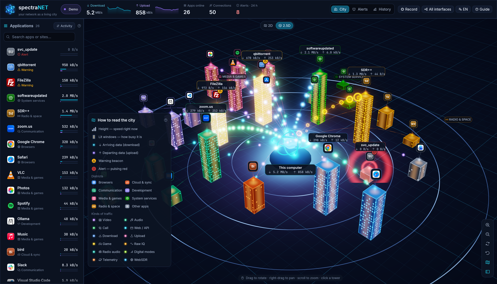

---

<a id="english"></a>

## English

spectraNET is a per-application network monitor. It measures every connection of every
program on the computer and presents it three ways:

| | |
|---|---|
| **`spectranet`** | the desktop app: the network drawn as an animated 2.5D city, with real app icons, plain-language explanations and a built-in guide |
| **`snet`** | the command-line tool, in the tradition of `top`, `nettop` and `ntop`, with man pages |
| **`snetd`** | the background service: continuous measurement, hostnames, history, alerts |

Everything is measured locally. spectraNET never decrypts or uploads your traffic; the only
things it downloads are public threat-intelligence lists.

### Version 1.0

spectraNET 1.0 is the first **stable** release. After seven releases in which every part was
built and tried on macOS, Linux and Windows, we consider it **complete and ready to be
distributed**:

- **Complete**: the desktop app, the `snet` command line and the `snetd` service cover the whole
  journey — seeing who uses the network, understanding what kind of traffic it is (video, calls,
  downloads, radio and satellites…), raising alerts, keeping history, and acting (pause, end,
  block).
- **Stable**: the same features on the three systems, checked on each one; the service's
  protocol and settings (`snetd.conf`) are now fixed, and from 1.0 on changes follow
  [semantic versioning](https://semver.org/): nothing that works today breaks in a 1.x release.
- **Ready to distribute**: installers for every system, the app installs and updates itself and
  its service, Options for every setting, five languages (English, Italian, French, German,
  Spanish), and the command line and service are **open source** (MIT OR Apache-2.0) so anyone
  can read, build and package them.

### Contents

- [Version 1.0](#version-10)
- [The city](#the-city)
- [2D map](#2d-map)
- [Network interfaces](#network-interfaces)
- [Inspecting an application](#inspecting-an-application)
- [Acting on an application](#acting-on-an-application)
- [What kind of traffic it is](#what-kind-of-traffic-it-is)
- [Radio & satellites](#radio--satellites)
- [Alerts](#alerts)
- [History](#history)
- [Guide and first-run introduction](#guide-and-first-run-introduction)
- [Languages](#languages)
- [Runs everywhere](#runs-everywhere)
- [Install](#install)
- [Options](#options)
- [Updates and support](#updates-and-support)
- [Command line: snet](#command-line-snet)
- [How it works](#how-it-works)
- [Accuracy](#accuracy)
- [Building from source](#building-from-source)
- [Project layout](#project-layout)
- [License](#license)

### The city


- The **nucleus** in the centre — the spectraNET logo, alive — is this computer. It glows
  brighter as traffic grows; the card beneath it shows total download and upload.
- Each **tower** is an application, topped by its **real icon** (read from the app bundle on
  macOS, the executable on Windows, the desktop entry and icon theme on Linux).
  **Height** is its speed right now (logarithmic, so a 10 kB/s chat and a 10 MB/s download
  both stay readable); **lit windows** show how busy it is.
- Towers live in **districts** by kind — browsers, cloud & sync, communication, development,
  media & games, system services, other apps — named on the ground and keyed in the legend.
  Colour always comes with a glyph and a name, never alone.
- **Particles of light** travel the beams: cyan towards the app (download), violet away from
  it (upload). More traffic, more particles.
- An **amber beacon** on a roof asks for a look; a **pulsing red beacon with radar rings** is
  an alert.
- Towers keep their place while the app is online, so the city becomes familiar; an app that
  closes its last connection fades away after about 20 seconds.

The top bar shows live download and upload with one-minute sparklines (hover for the value in
Mbit/s), applications online, open connections and alerts in the last 24 hours. The badge
next to the logo says where the data comes from (*Live · snetd*, *Live · direct*, *Demo*);
click it to learn more.

**Controls:** drag to rotate · right-drag or Shift-drag to pan · scroll or pinch to zoom ·
click a tower or its icon · double-click (or `R`) to reset the view · `V` switches 2D/2.5D ·
`Space` toggles the slow rotation · `L` the legend · `1 2 3` switch view · `Ctrl/⌘ F` searches · `F1` opens the guide.

### 2D map

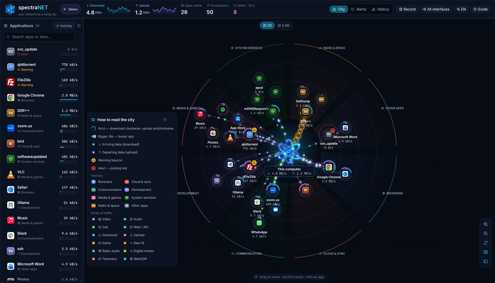

Prefer a plain map? The **2D | 2.5D** switch at the top of the city (or the `V` key) shows the
same districts from above. Each application is a tile with its icon inside a gauge: the arc
running **clockwise** from the top is its download speed, the one running **anticlockwise** its
upload speed (logarithmic: a half-turn is ~100 MB/s). Bigger tiles are busier apps; particles
flow along the links exactly as in 2.5D. Drag to move, scroll to zoom, click an app.

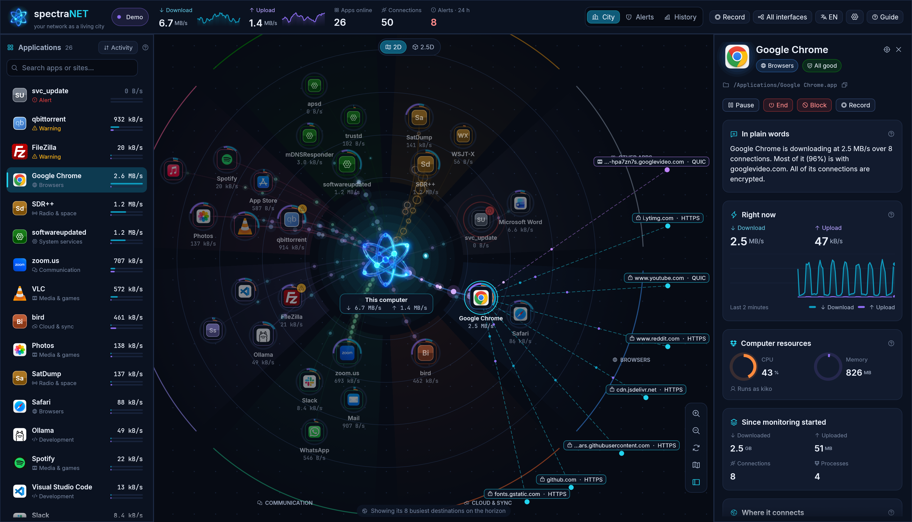

### Network interfaces

With more than one connection — Ethernet and Wi-Fi, a VPN, a phone tether — the interface menu
at the top right lists each one with its kind, address and live speed. Pick one and the city,
the list and every number count only the traffic that goes through it; *All interfaces* brings
everything back. (Connections without a local address, such as some UDP sockets, can't be
attributed to an interface and are counted only under *All interfaces*.)

### Inspecting an application

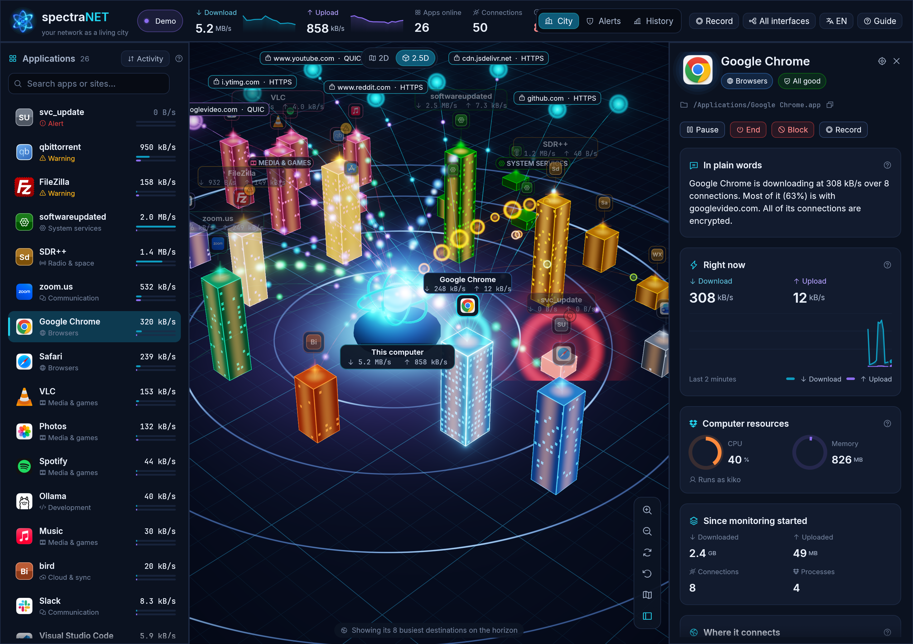

Click a tower, its icon or a row of the list. The camera frames the app, its destinations
rise on the horizon as a constellation linked by beams, and the inspector opens:

- **In plain words** — what the app is doing right now, which site gets most of its traffic,
  whether its connections are encrypted: *“Google Chrome is downloading at 308 kB/s over 8
  connections. Most of it (63%) is with googlevideo.com. All of its connections are encrypted.”*
- **Right now** — download and upload with a two-minute chart (hover for exact values).
- **Since monitoring started** — totals, connections and processes.
- **Where it connects** — every destination with its hostname (learned from DNS answers, TLS
  and QUIC handshakes, without decrypting anything), service (HTTPS, QUIC, DNS, SSH, IMAPS…)
  and a padlock: closed = encrypted, open = readable by anyone along the way, house = local
  network.
- **Processes** — the programs behind the app, with their PIDs and rates.

Flagged apps get a banner explaining the problem and **what you can do**.

The list on the left is searchable by app name, location, destination host or address, and
sortable by activity, total or name. Flagged apps always come first.

### Acting on an application

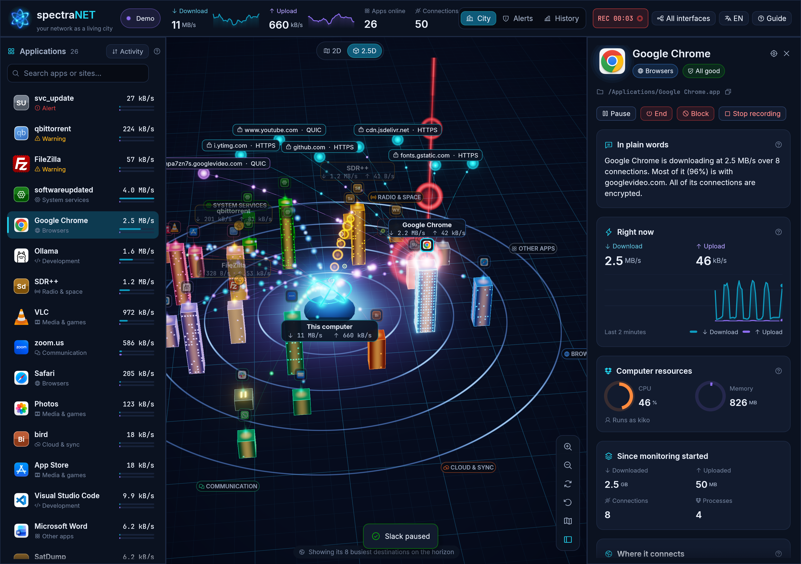

Right-click a tower, a tile or a row of the list, or use the buttons at the top of the
inspector:

- **Pause / Resume** — the app stops using processor and network until you resume it; its
  tower turns grey with a pause sign on the roof.
- **End** — the app is asked to quit; *Force end* stops it at once.
- **Close connection** — the plug next to a destination closes just that connection (Linux,
  Windows over IPv4).
- **Block** — cuts the app off the network for 15 minutes, an hour, a day or until unblocked;
  the no-entry sign next to a destination blocks that address for every app. Blocked towers
  are cordoned in red, and the red counter in the top bar lists the blocks and lifts them.
  Linux (eBPF) and Windows (Windows Filtering Platform) block the app's program file at once;
  macOS blocks the addresses the app uses as soon as they are seen (pf), so a new destination
  may get through for a moment. Blocks live in the snetd service: they come back when it
  restarts and vanish with it, so nothing can stay blocked by accident.
- **Record** — the Flight Recorder writes the app's traffic (or everything, from the top bar)
  to `Documents/spectraNET`, in the same format as `snet record`; a red beam tracks what is
  being recorded. Study the file with `snet analyze`.

**Computer resources**: a warm glow inside each tower (an orange ring inside each 2D tile) shows
how much processor the app uses; the inspector adds processor and memory rings and the app's
processes as a tree.

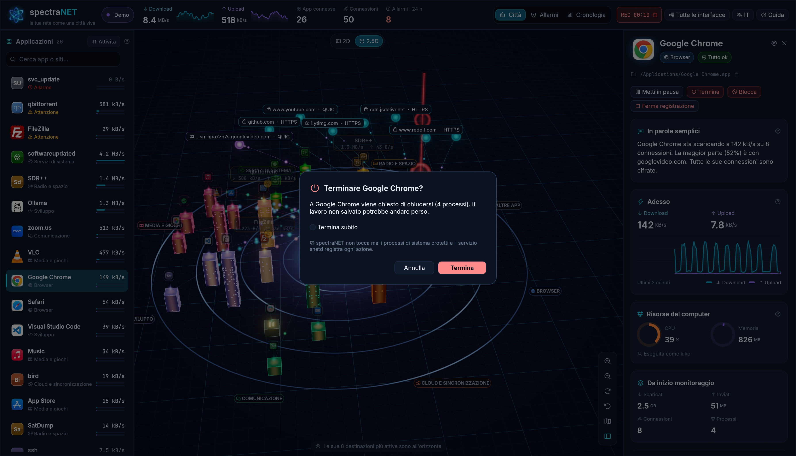

Every action is confirmed first and goes through the snetd service, which never touches
protected system processes (system, network, remote access) and records every action in its
audit log (`snet audit`). It never blocks the gateway, the DNS servers or the address of a
remote-access session (SSH, RDP, VNC). From the command line: `snet block <app|PID|IP> --for
1h`, `snet blocks`, `snet unblock <n>|--all`; in `snet top`, key `b`.

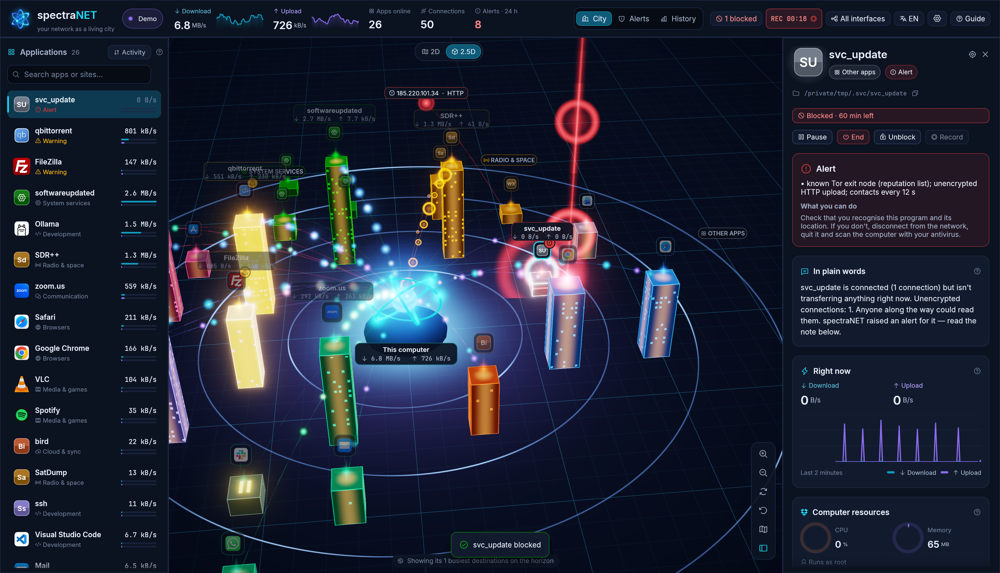

### What kind of traffic it is

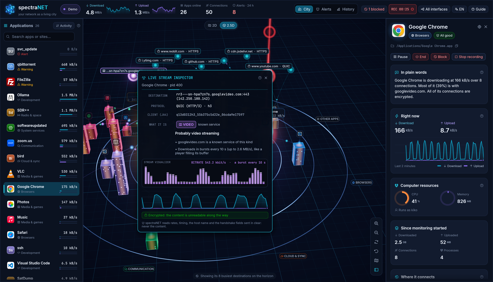

spectraNET tells what each connection probably carries — **video, music, a call, web pages
and APIs, a download, an upload or a game** — without decrypting anything and without reading
the content. It looks at:

- the **host**: a list of known services (video platforms, music, call services, update
  servers…), built in and refreshed by snetd ([data/categories.txt](data/categories.txt));
- the **pattern** over the last half minute: video downloads in regular bursts as the player
  fills its buffer, calls and games send small packets at a steady pace both ways, web pages
  are short exchanges, downloads and backups are sustained transfers;
- the **handshake**, sent in clear: TLS version, cipher suite, the protocols the client offers
  (h2, h3) and its **JA4** fingerprint (which TLS library or application opened it).

Each classification says how sure it is — *likely*, *very likely*, *known service* — and
**why**. No percentages, no guessed codecs or resolutions: encrypted traffic does not reveal
them.

Particles and beams take the colour of the traffic (cyan web, violet video, green audio and
calls, blue downloads, pink uploads, yellow games). **Click a destination** on the horizon or
on the 2D map, a connection in the inspector, or right-click an app and choose **Stream
inspector**, to open the **stream inspector**. It follows what the app exchanges with one host —
all its connections to it together, as browsers, video players and FTP open several — and
opens on the busiest one; the others are in the list at the top. It shows what it is
and why, the handshake, a live visualizer (an equalizer for video and audio, an oscilloscope
for calls and games, an exchange log for web traffic, a flowing bar for transfers) and the
bandwidth.

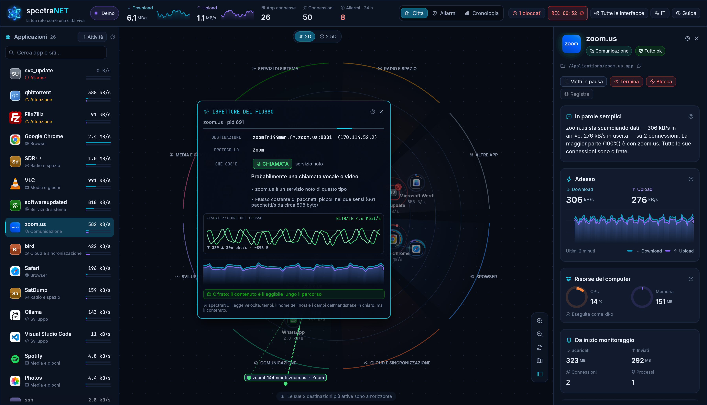

In the terminal: `snet top` → `f` opens the **Flow Inspector** (one row per destination, all its
connections together, with kind, protocol, TLS, JA4, reasons, and live waves of bandwidth and
packets); `snet stream --name
chrome` prints each classification as it happens (`--json` for NDJSON); `snet inspect --pid
4102` shows a process's network profile. After a day of learning, snetd raises an alert when
an application connects with a TLS client never seen for it.

### Radio & satellites

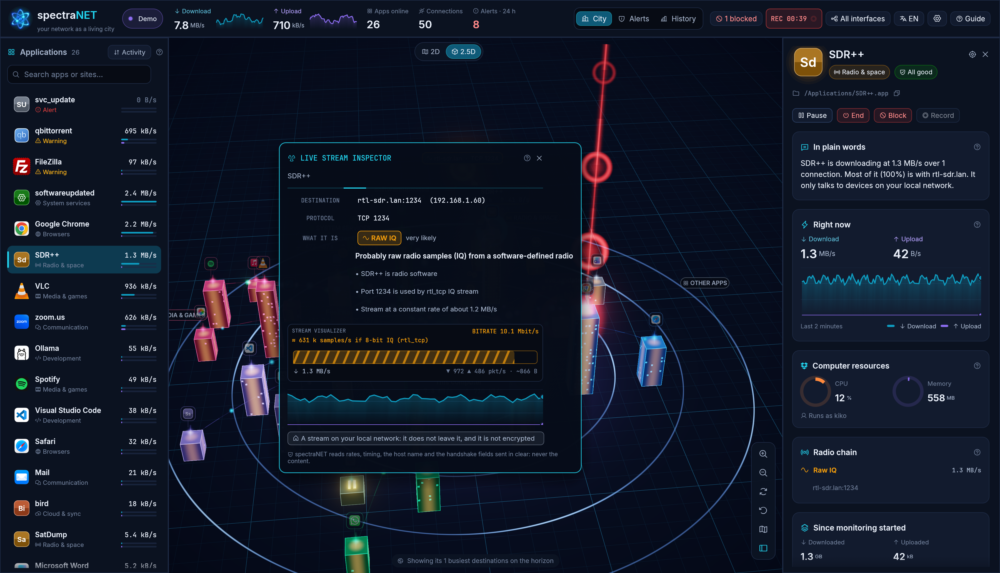

spectraNET knows software-defined radio and satellite reception. Receivers (SDR++, GQRX,
CubicSDR, SDRangel, SDR#, SDRuno, HDSDR), sample servers (rtl_tcp, SpyServer), decoders
(SatDump, WXtoImg, noaa-apt, dump1090, readsb, rtl_433), digital modes (WSJT-X, JTDX, JS8Call,
fldigi, Direwolf, GridTracker) and web receivers (OpenWebRX, KiwiSDR) get their own district,
**Radio & space**, and their connections are recognised as:

| Kind | How it is recognised |
|---|---|
| **Raw IQ** | a radio program, or rtl_tcp (1234) / SpyServer (5555), with a constant, high rate; for rtl_tcp the stream inspector estimates the sample rate |
| **Radio audio** | a receiver streaming at a modest, steady rate (demodulated audio, DSP) |
| **Digital modes** | WSJT-X (UDP 2237), APRS-IS (14580), PSK Reporter (UDP 4739) |
| **Telemetry** | decoders uploading to SatNOGS, orbit data from CelesTrak, ADS-B (30003, 30005) |
| **WebSDR** | OpenWebRX and KiwiSDR (8073), WebSDR.org |

Radio streams travel through the city as pulsing rings. The inspector's **Radio chain** card
says what an application feeds or receives, naming local pipelines (127.0.0.1) as such. Ports
shared with other software (5555 is also Android's ADB, 1234 is everywhere) never count alone:
they need a radio program or a stream that looks like radio samples. No IQ sample, audio or
image is ever read. In the terminal: `snet list --domain radio`, `snet stream --domain radio`.

### Alerts

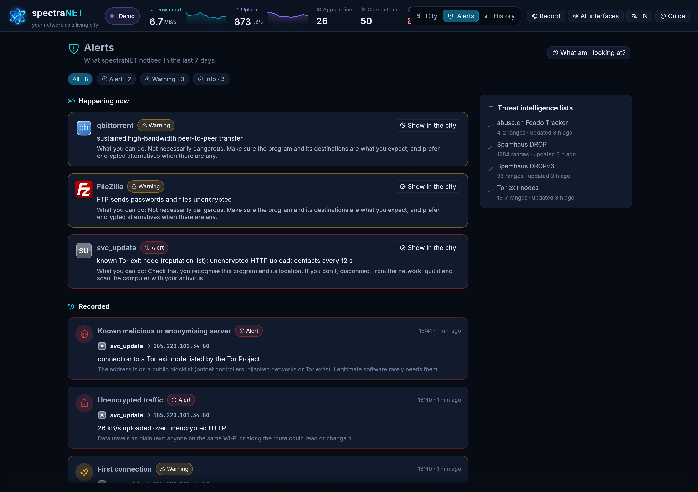

*Happening now* lists applications flagged at this moment; *Recorded* lists everything the
service noticed in the last 7 days, filterable by severity. Each card says what happened, to
which app and address, **why it matters** and what to do. Rules:

| Rule | Meaning |
|---|---|
| Known malicious or anonymising server | the address is on abuse.ch **Feodo Tracker** (botnet controllers), **Spamhaus DROP/DROPv6** (hijacked networks) or the **Tor exit** list — refreshed every 12 hours |
| Unencrypted traffic | HTTP, FTP, Telnet and similar to the internet |
| First connection | a program contacted a destination for the first time |
| Beaconing / heavy upload | found by `snet record` + `snet analyze` (clockwork check-ins, upload-dominated traffic) |

The panel on the right shows the threat-intelligence lists loaded by the service and when they
were last updated.

### History

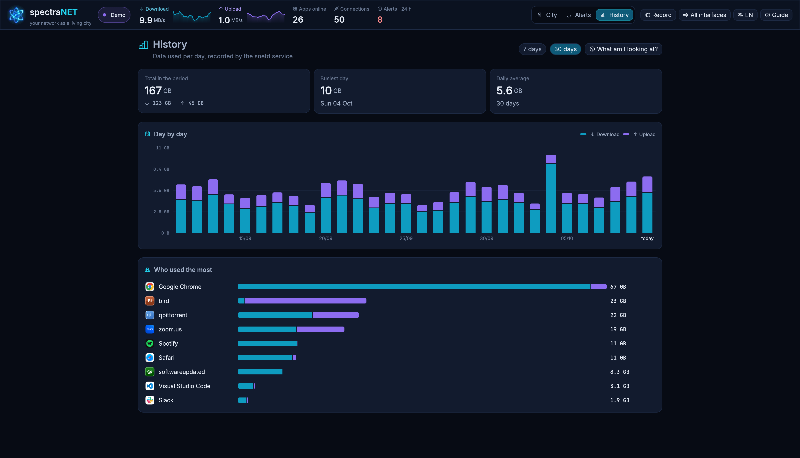

The snetd service counts every byte per application and per day, even when the app is closed.
The History view shows the last 7 or 30 days: period total, busiest day, daily average, a
day-by-day chart (download and upload stacked, hover for exact numbers) and the applications
that used the most.

### Guide and first-run introduction

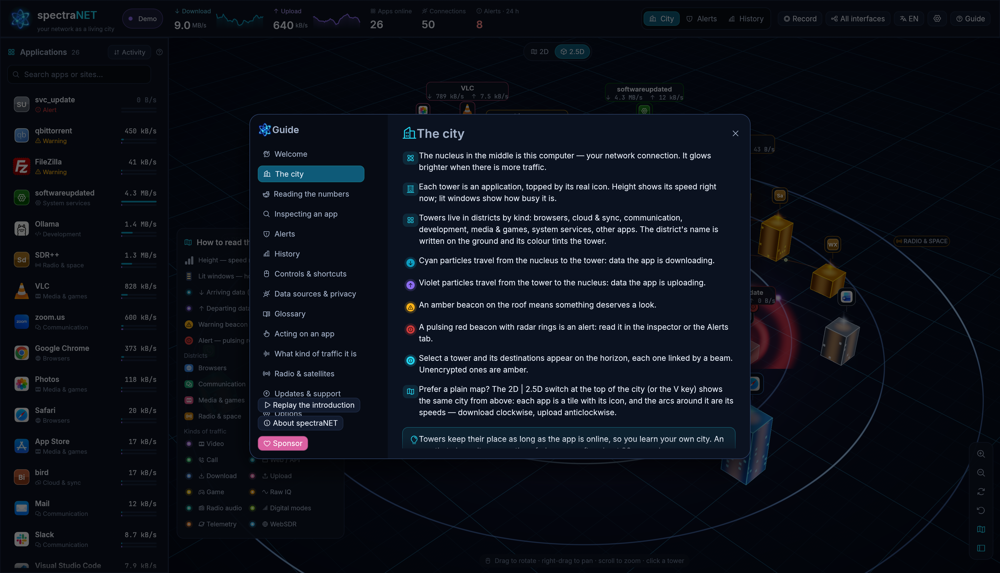

The **Guide** (top right, or `F1`) explains everything in nine short chapters: welcome, the
city, reading the numbers, inspecting an app, alerts, history, controls & shortcuts, data
sources & privacy, and a glossary (bandwidth, host, port, TLS, QUIC, DNS, Tor, beaconing…).
Every panel has a **?** button that opens the guide at the right chapter.

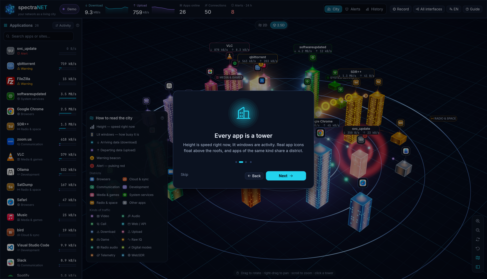

On first launch a four-step introduction teaches how to read the city. It can be replayed from
the guide or the language menu.

### Languages

The interface follows the system language and switches instantly from the language menu
(top right) or *Options → General*. English, Italian, French, German and Spanish are included,
the guide and the introduction too.

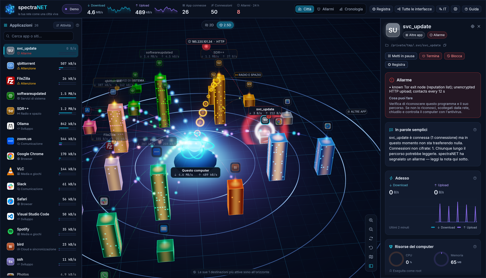

### Runs everywhere

The same app, the same city, on every system — each with its native graphics API and its
own application icons.

| Windows 11 · DirectX 12 · 2.5D · stream inspector | Linux (Debian 13) · Vulkan · 2D map |
|---|---|
| 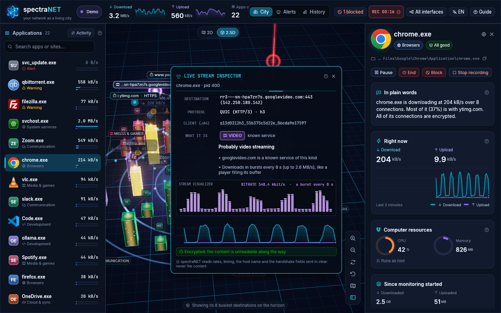 | 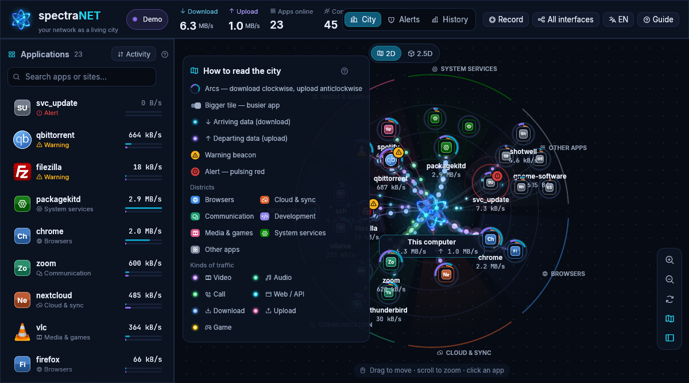 |

### Install

Download the package for your system from the
[Releases](https://github.com/kikoz85/spectraNET/releases) page.

**macOS** (11 or later, Apple silicon and Intel)

1. Open `spectraNET-<version>-macos-universal.dmg` and drag **spectraNET** to Applications.
2. The app is not notarised: the first time, right-click it and choose **Open**.
3. Install the background service (recommended): open the app and click **Install service** in
   the bar under the top bar (macOS asks for your password). Or from the CLI archive:
   ```sh
   tar xzf spectranet-cli-<version>-macos-universal.tar.gz
   cd spectranet-cli-<version>-macos-universal
   sudo ./snetd install        # also installs snet and the man pages
   ```

**Linux** (x86-64, kernel 5.8+ with BTF — every current distribution)

- **AppImage** (any distribution, nothing to install):
  ```sh
  chmod +x spectraNET-<version>-x86_64.AppImage
  ./spectraNET-<version>-x86_64.AppImage                  # the app
  sudo ./spectraNET-<version>-x86_64.AppImage snetd install   # the background service
  ```
  The same file runs the command-line tools: `./spectraNET-….AppImage snet top`.
- **Debian / Ubuntu**:
  ```sh
  sudo apt install ./spectranet_<version>_amd64.deb
  sudo snetd install                                   # systemd service
  sudo usermod -aG sudo "$USER"                        # members of sudo/wheel may read it
  ```
- Or unpack `spectranet-<version>-linux-x86_64.tar.gz` under `/usr/local`.

**Windows** (10/11, x64)

1. Run `spectraNET-<version>-windows-x86_64-setup.exe` (English or Italian). It installs the
   app in `C:\Program Files\spectraNET`, adds it to the Start menu and, unless you untick it,
   starts the background service; it can also put `snet` on the PATH.
2. Open **spectraNET** from the Start menu — no "Run as administrator" needed: the setup
   authorises the account that installed it and the one signed in at the computer.
3. Uninstall from *Settings → Apps*: the service is removed too (the usage history stays in
   `C:\ProgramData\spectraNET`).

A portable `spectranet-<version>-windows-x86_64.zip` is also available
(`.\snetd.exe install` from an administrator PowerShell installs the service).

**Command line only** — `snet` and the `snetd` service, without the desktop app, for servers,
terminals and scripts. One command, from the latest release (checked against its
`SHA256SUMS.txt` before installing):

```sh
curl -fsSL https://github.com/kikoz85/spectraNET/releases/latest/download/install.sh | sh
```

```powershell
irm https://github.com/kikoz85/spectraNET/releases/latest/download/install.ps1 | iex
```

Or the packages, from the Releases page:

| System | Package | Installs |
|---|---|---|
| macOS | `spectranet-cli-<version>-macos-universal.pkg` | open it: `snet`, `snetd` and the man pages in `/usr/local`, service started |
| Debian / Ubuntu | `spectranet-cli_<version>_amd64.deb` | `sudo apt install ./spectranet-cli_<version>_amd64.deb`: service started |
| Windows | `spectranet-cli-<version>-windows-x86_64-setup.exe` | service started, `snet` on the PATH |
| any | `spectranet-cli-<version>-<system>.tar.gz` / `.zip` | unpack, then `sudo ./snetd install` |

Then `snet top` (or `snet list`, `snet status`, `man snet`). Remove with `sudo snetd uninstall`
(Windows: *Settings → Apps*). The desktop app includes all of this: install one or the other.

Without the service the app still works: it measures traffic itself (*Live · direct*), with
fewer hostnames and no history or alerts. To just look around: `spectranet --demo`.

### Options

The gear at the top right (or <kbd>⌘</kbd> <kbd>,</kbd> / <kbd>Ctrl</kbd> <kbd>,</kbd>) opens
**Options**, every setting in one place:

| Section | What it holds |
|---|---|
| **General** | language, open spectraNET when you log in, the view shown at start, the introduction |
| **City & graphics** | legend, rotation, graphics quality (*High*, *Balanced*, *Power saving* for laptops on battery and remote desktops), the system's own services, hiding apps without traffic |
| **Units & data** | speeds in bytes (MB/s) or bits (Mbit/s), the network interface, the Flight Recorder folder |
| **Notifications** | desktop notifications for alerts, warnings and apps connecting for the first time |
| **Updates** | automatic checks, updating the service by itself |
| **snetd service** | status, who may act on apps, threat lists, history kept, Prometheus metrics, reinstall or remove |
| **Advanced** | data folders, restore default settings |

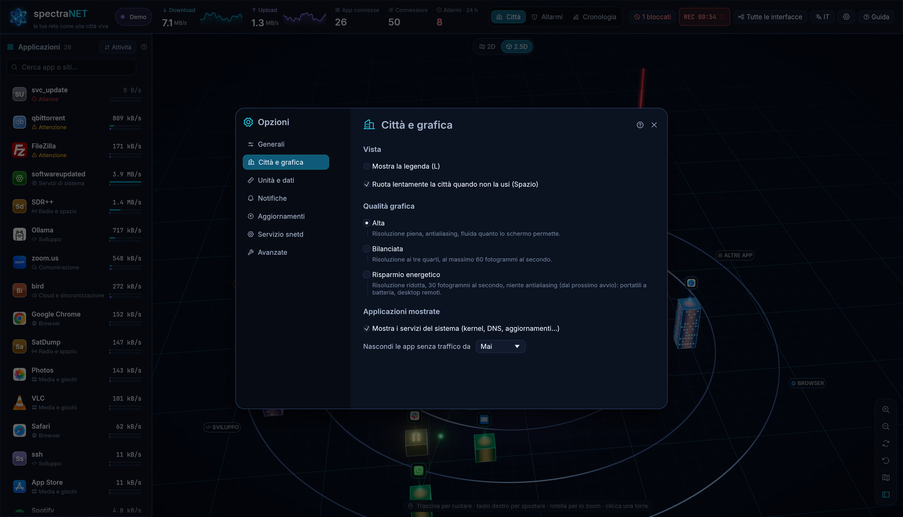

The service's settings are applied together (one administrator prompt; the service restarts).
From a terminal they are `snetd config show` and `sudo snetd config set KEY=VALUE…`, e.g.
`sudo snetd config set history_days=90 feeds_disabled=tor-exits`.

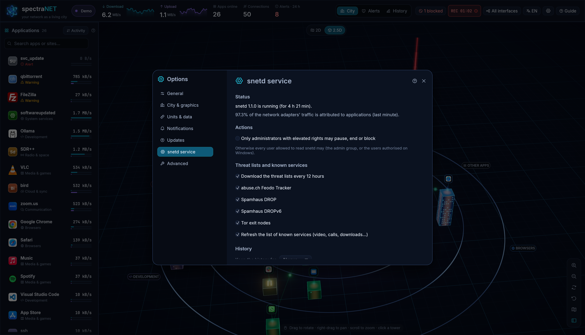

### Updates and support

spectraNET checks the releases now and then. When a new version is out, a bar under the top bar
offers to **install it and restart**: the app downloads the package for your kind of
installation (macOS app, Windows installer, Linux AppImage or Debian package), checks it against
the release's `SHA256SUMS.txt`, installs it together with the snetd service (one administrator
prompt) and starts again. When the service is missing or older than the app, the same bar
offers to install or update it. The portable zip and the tarballs open the releases page
instead.

**About spectraNET** (click the logo at the top left) shows your version, *Check for updates*
and the switch for automatic checks.

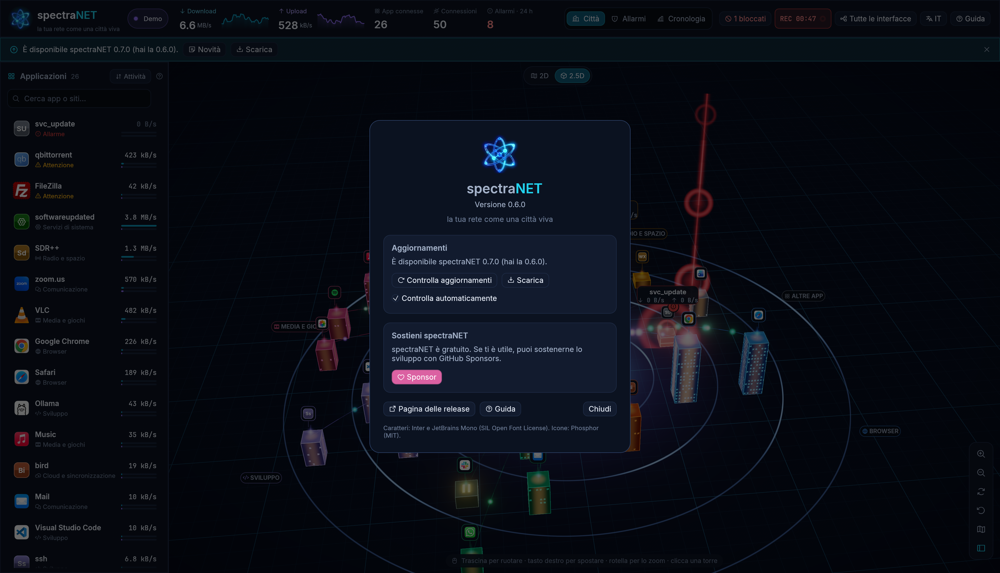

spectraNET is free. If it is useful to you, you can support its development with
**[GitHub Sponsors](https://github.com/sponsors/kikoz85)** — the Sponsor button is also in the
app, in the guide and in *About spectraNET*.

### Command line: snet

```sh
snet top                      # interactive full-screen view (press ? for keys, f for flows)
snet stream --name chrome     # what kind of traffic each connection carries, as it is recognised
snet inspect --pid 4102       # a process's network profile: kinds, protocols, TLS, JA4
snet list --domain radio      # software-defined radio and satellite programs only
snet list                     # applications using the network, busiest first
snet list -c --sort down      # with active connections (-cc: all), sorted by download
snet list --by-process        # one row per process instead of per application
snet list --json              # machine-readable output
snet watch --name chrome      # live view, refreshed every second
snet status                   # is snetd running? which lists are loaded?
snet history --days 7         # data used per app and per day
snet alerts --since 7d        # blocklisted addresses, cleartext, first connections
snet record --name zoom --duration 10m   # Flight Recorder: every connection, sample by sample
snet analyze snet-record-*.jsonl         # destinations, beaconing, heavy uploads, cleartext
```

Every command is documented in its man page: `man snet`, `man snet-list`, `man snetd`,
`man spectranet`… Shell completions: `snet generate completions <bash|zsh|fish|powershell|elvish>`.

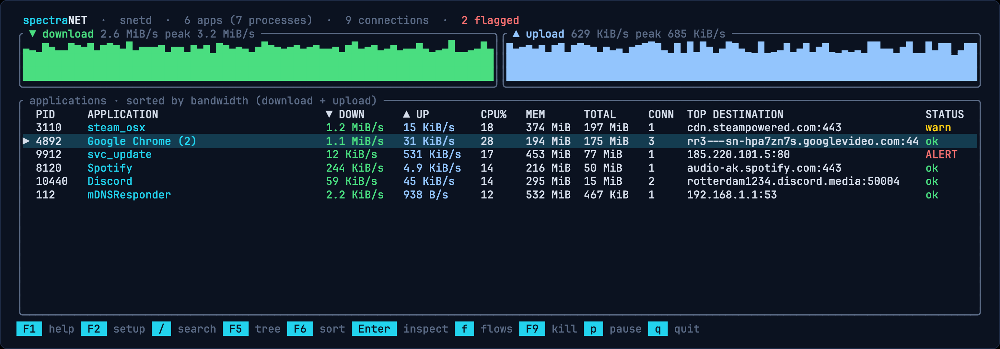

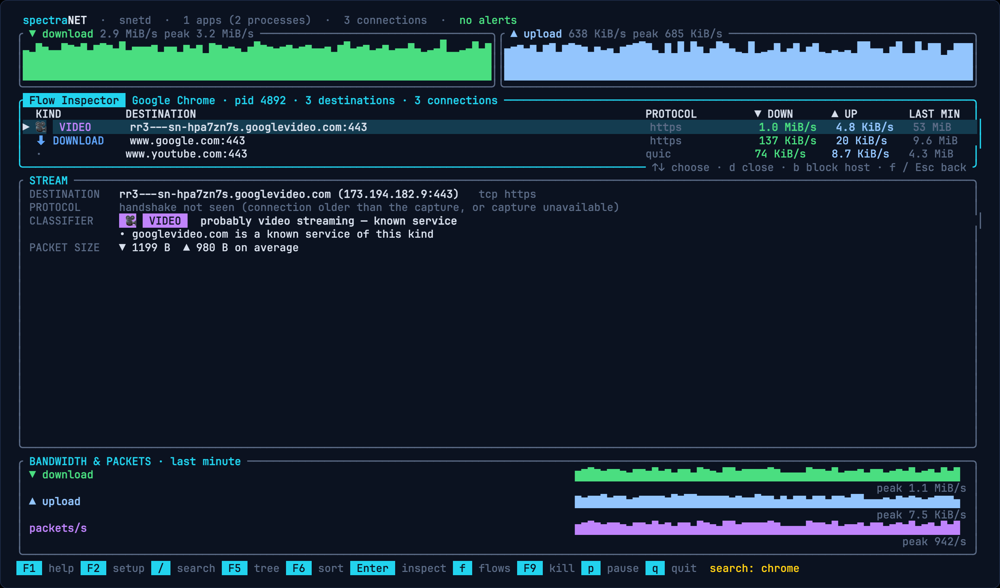

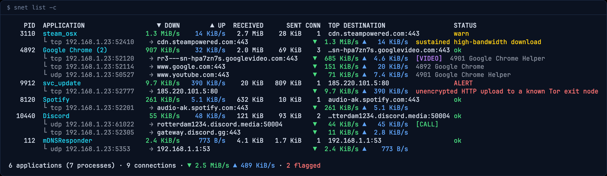

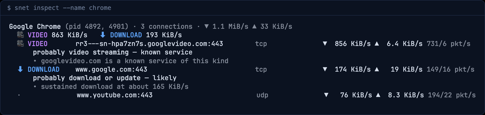

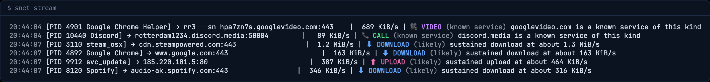

### Prometheus metrics

Off by default. To let Prometheus (or Grafana Agent, VictoriaMetrics…) collect per-application
traffic, CPU and memory, turn them on in *Options → snetd service*, or add to `snetd.conf` in the data directory
(`/Library/Application Support/spectraNET` on macOS, `/var/lib/spectranet` on Linux,
`%ProgramData%\spectraNET` on Windows) and restart the service:

```toml
metrics = "127.0.0.1:9790"
```

or run `snetd run --metrics 127.0.0.1:9790`. Then scrape `http://127.0.0.1:9790/metrics`:

```yaml
scrape_configs:
  - job_name: spectranet
    static_configs:
      - targets: ["127.0.0.1:9790"]
```

Per application (label `app`): `spectranet_app_receive_bytes_total`,
`spectranet_app_transmit_bytes_total`, `…_bytes_per_second`, `spectranet_app_connections`,
`spectranet_app_cpu_percent`, `spectranet_app_memory_bytes`; and for the service:
`spectranet_alerts_last_24h`, `spectranet_blocks`, `spectranet_samples_total`. Keep the
address on `127.0.0.1` unless you mean to publish it: the metrics tell which applications run.

### How it works

| | Traffic per process | Hostnames |
|---|---|---|
| **macOS** | the system's NetworkStatistics framework (the source of `nettop`) | DNS answers, TLS SNI and QUIC Initial packets observed with libpcap |
| **Linux** | an eBPF program (CO-RE) on the kernel's TCP/UDP send and receive paths, plus `sock_diag` for idle connections | same, via libpcap |
| **Windows** | Event Tracing for Windows (Microsoft-Windows-Kernel-Network) plus the TCP tables | the DNS-Client event provider |

Reverse lookups (mDNS, NetBIOS, the gateway's DNS) are made only for addresses on the local
network. snetd keeps history and alerts in SQLite under `/Library/Application Support/spectraNET`,
`/var/lib/spectranet` or `C:\ProgramData\spectraNET`, and serves clients over a Unix socket
(group admin/sudo/wheel) or a named pipe (Administrators).

The desktop app uses its own 3D renderer (Metal on macOS,
DirectX 12 on Windows, Vulkan or OpenGL on Linux): HDR rendering with multisampling, bloom and
ACES tone mapping, about 2 ms per frame on an Apple M1 Max.

### Accuracy

snetd does not sit in the path of your traffic and does not capture every packet: it reads the
byte counters the kernel already keeps for every socket of every process. Nothing can slow
down or break the network, and the numbers are the kernel's own — not a guess from sniffed
packets matched to processes afterwards.

**Reconciliation with the network interfaces.** Every second snetd also reads the counters of
the network adapters (loopback, tunnels, bonds' members and other virtual interfaces left out,
so nothing is counted twice) and compares them with what the applications' connections account
for, packet headers included. `snet status`, `snet list`, `snet top`, the app (hover the
*Live* badge, or *Options → snetd service*) and the Prometheus metrics show the share:

```
coverage: 98.3% of the traffic on bond0 attributed to applications over the last 60 s
```

What is left is traffic no program on this computer owns — other devices shared or bridged
through it, the system's own protocols — or a fault worth reporting: a blind spot can't hide.

**Tested on real networks.** `snet-qa` (in the open-source repository) runs known transfers
against another computer and compares, byte for byte, what the capture measured. Results for
1.1.0, over a gigabit local network:

| Scenario | macOS (NetworkStatistics) | Linux (eBPF) | Windows (ETW) |
|---|---|---|---|
| 200 MB download | exact (+0.001%) | exact | exact |
| 100 MB upload | exact | exact | exact |
| 4 parallel downloads, 100 MB | +0.05% | exact | exact |
| 200 connections of 50 kB, a few ms each | exact, 200/200 seen | exact, 200/200 | exact, 200/200 |
| long quiet connection (15 × 64 bytes) | exact | +1 byte | exact |
| 20 MB of UDP | exact | exact | exact |
| interfaces' traffic attributed | 94–100% | 94–100% | 96–100% |

The parsers that read names off the network (DNS, TLS, QUIC, link-layer frames) are fuzzed with
80,000 malformed inputs on every test run, and snetd's CPU and memory are recorded over 24-hour
runs (`snet-qa soak`).

### Building from source

The command-line tool `snet`, the service `snetd` and the libraries they use are open source and
live in this repository. The desktop app (`spectranet`) is distributed as ready-made packages
only, on the [Releases](https://github.com/kikoz85/spectraNET/releases) page.

**Requirements**: [Rust](https://rustup.rs) 1.88 or later, and:

| System | Also needed |
|---|---|
| **macOS** 11+ | Xcode Command Line Tools: `xcode-select --install` (libpcap is part of macOS) |
| **Linux** (kernel 5.8+ with BTF) | `clang` (compiles the eBPF probe) and libpcap headers — Debian/Ubuntu: `sudo apt install build-essential clang libpcap-dev`; Fedora: `sudo dnf install clang libpcap-devel`; Arch: `sudo pacman -S base-devel clang libpcap` |
| **Windows** 10/11 | Visual Studio Build Tools with *Desktop development with C++*, and the MSVC Rust toolchain (`rustup default stable-msvc`) |

**Build and test**:

```sh
git clone https://github.com/kikoz85/spectraNET.git
cd spectraNET
cargo build --release          # target/release/snet and snetd (snet.exe, snetd.exe on Windows)
cargo test                     # the whole test suite
./target/release/snet --mock top   # try it with simulated traffic, no privileges needed
```

**Install the service** (it also installs `snet` and the man pages):

```sh
sudo ./target/release/snetd install          # macOS and Linux
```

```powershell
.\target\release\snetd.exe install           # Windows, from an administrator PowerShell
```

`snetd uninstall` removes it again (`--purge` also deletes the history).

**Check the accuracy on your network**: run `snet-qa serve` on another computer, then on this
one `snet-qa run --peer OTHER:47800` (as administrator on Linux and Windows). Every scenario is
compared byte for byte with what the capture measured; `snet-qa soak --name snetd --out
snetd.csv` records CPU and memory over time. Shell completions:
`snet generate completions <bash|zsh|fish|powershell|elvish>`; man pages: `snet generate man DIR`.

### Project layout

| Path | Contents |
|---|---|
| `crates/spectranet-model` | Data types shared by every component (snapshot, process, flow) |
| `crates/spectranet-capture` | Traffic sources: macOS (NetworkStatistics), Linux (eBPF), Windows (ETW), name discovery, simulator |
| `crates/spectranet-intel` | Traffic classification, security rules, reputation lists, Flight Recorder analysis |
| `crates/spectranet-proto` | Protocol between clients and `snetd` (JSON lines over a socket or named pipe) |
| `crates/spectranet-daemon` | `snetd`: continuous sampling, history, alerts, actions, service installation |
| `crates/spectranet-cli` | `snet`: commands, full-screen `top`, man pages, completions |
| `crates/spectranet-qa` | `snet-qa`: accuracy and endurance tests on real networks (see Accuracy) |
| `ebpf/` | The Linux kernel probes (GPL-2.0) |
| `data/` | The list of known services, refreshed by `snetd` from this repository |

### License

`snet`, `snetd` and their libraries are licensed under either of [MIT](LICENSE-MIT) or
[Apache-2.0](LICENSE-APACHE), at your option. The eBPF programs in `ebpf/` are GPL-2.0, as the
Linux kernel requires. The desktop app is free to download and use, but its source is not
published.

---

<a id="italiano"></a>

## Italiano

spectraNET è un monitor di rete per applicazione. Misura ogni connessione di ogni programma
del computer e la presenta in tre modi:

| | |
|---|---|
| **`spectranet`** | l'app desktop: la rete disegnata come una città 2.5D animata, con le vere icone delle app, spiegazioni in parole semplici e una guida integrata |
| **`snet`** | lo strumento da riga di comando, nella tradizione di `top`, `nettop` e `ntop`, con le pagine man |
| **`snetd`** | il servizio in background: misura continua, nomi degli host, cronologia, allarmi |

Tutto viene misurato in locale. spectraNET non decifra né invia mai il tuo traffico; le uniche
cose che scarica sono le liste pubbliche di threat intelligence.

### Versione 1.0

spectraNET 1.0 è la prima versione **stabile**. Dopo sette versioni in cui ogni parte è stata
costruita e provata su macOS, Linux e Windows, la riteniamo **completa e pronta per essere
distribuita**:

- **Completa**: l'app desktop, la riga di comando `snet` e il servizio `snetd` coprono tutto il
  percorso — vedere chi usa la rete, capire che tipo di traffico è (video, chiamate, download,
  radio e satelliti…), generare allarmi, conservare la cronologia e agire (pausa, termina,
  blocca).
- **Stabile**: le stesse funzioni sui tre sistemi, verificate su ognuno; il protocollo e le
  impostazioni del servizio (`snetd.conf`) sono ora definitivi e da qui in poi i cambiamenti
  seguono il [versionamento semantico](https://semver.org/lang/it/): niente di ciò che funziona
  oggi si rompe in una versione 1.x.
- **Pronta da distribuire**: installer per ogni sistema, l'app si installa e si aggiorna da sola
  insieme al suo servizio, le Opzioni per ogni impostazione, cinque lingue (inglese, italiano,
  francese, tedesco, spagnolo), e la riga di comando e il servizio sono **open source** (MIT OR
  Apache-2.0), così chiunque può leggerli, compilarli e pacchettizzarli.

### Indice

- [Versione 1.0](#versione-10)
- [La città](#la-città)
- [Mappa 2D](#mappa-2d)
- [Interfacce di rete](#interfacce-di-rete)
- [Ispezionare un'applicazione](#ispezionare-unapplicazione)
- [Agire su un'applicazione](#agire-su-unapplicazione)
- [Che tipo di traffico è](#che-tipo-di-traffico-è)
- [Radio e satelliti](#radio-e-satelliti)
- [Allarmi](#allarmi)
- [Cronologia](#cronologia)
- [Guida e introduzione al primo avvio](#guida-e-introduzione-al-primo-avvio)
- [Lingue](#lingue)
- [Su ogni sistema](#su-ogni-sistema)
- [Installazione](#installazione)
- [Opzioni](#opzioni)
- [Aggiornamenti e sostegno](#aggiornamenti-e-sostegno)
- [Riga di comando: snet](#riga-di-comando-snet)
- [Come funziona](#come-funziona)
- [Affidabilità](#affidabilità)
- [Compilare dai sorgenti](#compilare-dai-sorgenti)
- [Struttura del progetto](#struttura-del-progetto)
- [Licenza](#licenza)

### La città

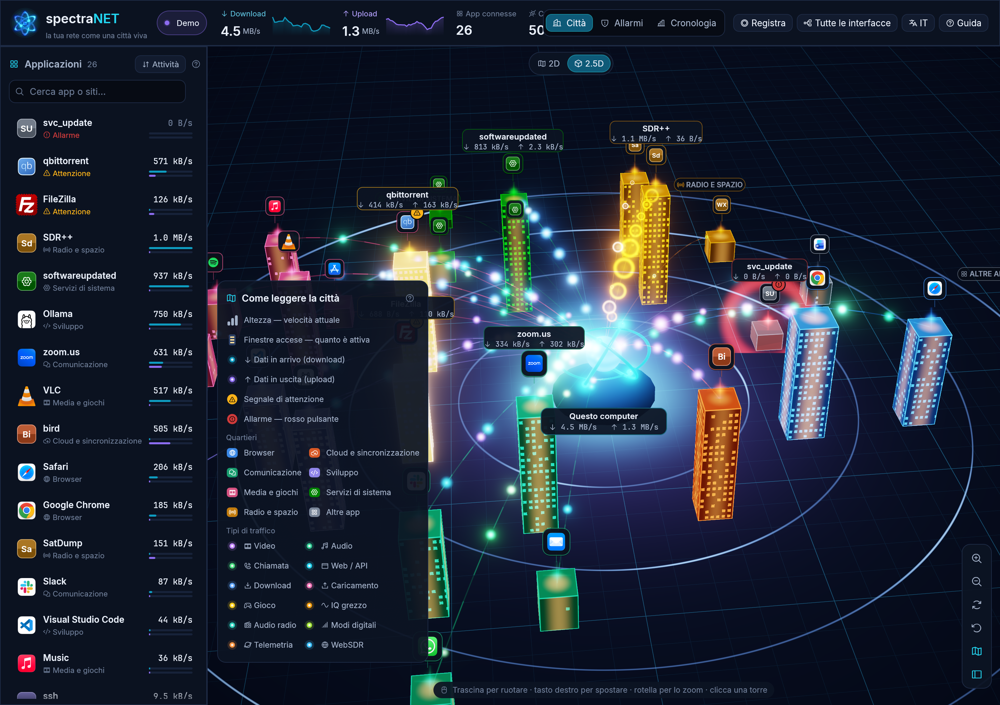

- Il **nucleo** al centro — il logo di spectraNET, vivo — è questo computer. Brilla di più
  quando il traffico cresce; la scheda sotto mostra download e upload totali.
- Ogni **torre** è un'applicazione, con in cima la sua **vera icona** (letta dal bundle
  dell'app su macOS, dall'eseguibile su Windows, dal file .desktop e dal tema di icone su
  Linux). L'**altezza** è la velocità attuale (logaritmica, così una chat a 10 kB/s e un
  download a 10 MB/s restano entrambi leggibili); le **finestre accese** indicano quanto è
  attiva.
- Le torri abitano in **quartieri** per tipo — browser, cloud e sincronizzazione,
  comunicazione, sviluppo, media e giochi, servizi di sistema, altre app — con il nome scritto
  a terra e riportato nella legenda. Il colore è sempre accompagnato da un simbolo e da un nome.
- **Particelle di luce** percorrono i raggi: ciano verso l'app (download), viola dall'app
  (upload). Più traffico, più particelle.
- Un **segnale ambra** sul tetto chiede un'occhiata; un **segnale rosso pulsante con onde
  radar** è un allarme.
- Le torri mantengono il loro posto finché l'app è in linea, così la città diventa familiare;
  un'app che chiude l'ultima connessione svanisce dopo circa 20 secondi.

La barra in alto mostra download e upload in tempo reale con l'andamento dell'ultimo minuto
(passa sopra per il valore in Mbit/s), app connesse, connessioni aperte e allarmi delle ultime
24 ore. Il badge accanto al logo indica la sorgente dei dati (*In diretta · snetd*, *In
diretta · diretta*, *Demo*); cliccalo per saperne di più.

**Comandi:** trascina per ruotare · tasto destro o Maiusc + trascina per spostarti · rotella o
pizzico per lo zoom · clic su una torre o sulla sua icona · doppio clic (o `R`) per ripristinare
la vista · `V` passa da 2D a 2.5D · `Spazio` attiva la rotazione lenta · `L` la legenda · `1 2 3` cambiano vista ·
`Ctrl/⌘ F` cerca · `F1` apre la guida.

### Mappa 2D

Preferisci una mappa semplice? Il selettore **2D | 2.5D** in alto nella città (o il tasto `V`)
mostra gli stessi quartieri visti dall'alto. Ogni applicazione è una piastrella con la sua
icona dentro un indicatore: l'arco che parte dall'alto in **senso orario** è la velocità di
download, quello in **senso antiorario** l'upload (logaritmici: mezzo giro è circa 100 MB/s).
Le piastrelle più grandi sono le app più attive; le particelle scorrono sui collegamenti come in
2.5D. Trascina per spostarti, rotella per lo zoom, clic su un'app.

### Interfacce di rete

Con più di una connessione — cavo e Wi-Fi, una VPN, l'hotspot del telefono — il menu delle
interfacce in alto a destra le elenca con tipo, indirizzo e velocità in tempo reale. Scegline
una e la città, l'elenco e tutti i numeri contano solo il traffico che passa da lì; *Tutte le
interfacce* riporta tutto. (Le connessioni senza indirizzo locale, come alcuni socket UDP, non
si possono attribuire a un'interfaccia e sono contate solo in *Tutte le interfacce*.)

### Ispezionare un'applicazione


Clicca una torre, la sua icona o una riga dell'elenco. La telecamera inquadra l'app, le sue
destinazioni salgono all'orizzonte come una costellazione collegata da raggi e si apre
l'ispettore:

- **In parole semplici** — cosa sta facendo l'app adesso, quale sito riceve la maggior parte
  del traffico, se le connessioni sono cifrate.
- **Adesso** — download e upload con il grafico degli ultimi due minuti.
- **Da inizio monitoraggio** — totali, connessioni e processi.
- **Dove si collega** — ogni destinazione con il nome dell'host (ricavato dalle risposte DNS e
  dalle negoziazioni TLS e QUIC, senza decifrare nulla), il servizio (HTTPS, QUIC, DNS, SSH,
  IMAPS…) e un lucchetto: chiuso = cifrata, aperto = leggibile da chiunque lungo il percorso,
  casa = rete locale.
- **Processi** — i programmi dietro l'app, con PID e velocità.

Le app segnalate hanno un riquadro che spiega il problema e **cosa puoi fare**.

L'elenco a sinistra si può cercare per nome, percorso, host o indirizzo di destinazione e
ordinare per attività, totale o nome. Le app segnalate sono sempre in cima.

### Agire su un'applicazione


Clic destro su una torre, una tessera o una riga dell'elenco, oppure i pulsanti in cima
all'ispettore:

- **Metti in pausa / Riprendi** — l'app smette di usare processore e rete finché non la
  riprendi; la sua torre diventa grigia con il simbolo di pausa sul tetto.
- **Termina** — all'app viene chiesto di chiudersi; *Termina subito* la ferma all'istante.
- **Chiudi connessione** — la spina accanto a una destinazione chiude solo quella connessione
  (Linux, Windows su IPv4).
- **Blocca** — taglia fuori l'app dalla rete per 15 minuti, un'ora, un giorno o finché non la
  sblocchi; il divieto accanto a una destinazione blocca quell'indirizzo per tutte le app. Le
  torri bloccate hanno un cordone rosso e il contatore rosso nella barra in alto elenca i
  blocchi e li toglie. Linux (eBPF) e Windows (Windows Filtering Platform) bloccano subito il
  file del programma; macOS blocca gli indirizzi usati dall'app appena li vede (pf), quindi una
  destinazione nuova può passare per un attimo. I blocchi vivono nel servizio snetd: tornano
  quando si riavvia e spariscono con lui, così nulla può restare bloccato per errore.
- **Registra** — il Flight Recorder scrive il traffico dell'app (o di tutto, dalla barra in
  alto) in `Documenti/spectraNET`, nello stesso formato di `snet record`; un fascio rosso
  segue ciò che si sta registrando. Studia il file con `snet analyze`.

**Risorse del computer**: un bagliore caldo dentro ogni torre (un anello arancione dentro ogni
tessera 2D) mostra quanto processore usa l'app; l'ispettore aggiunge gli anelli di processore e
memoria e i processi dell'app come albero.


Ogni azione va prima confermata e passa dal servizio snetd, che non tocca mai i processi di
sistema protetti (sistema, rete, accesso remoto) e registra ogni azione nel suo registro di
audit (`snet audit`). Non blocca mai il gateway, i server DNS o l'indirizzo di una sessione di
accesso remoto (SSH, RDP, VNC). Da riga di comando: `snet block <app|PID|IP> --for 1h`,
`snet blocks`, `snet unblock <n>|--all`; in `snet top`, tasto `b`.


### Che tipo di traffico è


spectraNET dice che cosa trasporta probabilmente ogni connessione — **video, musica, una
chiamata, pagine web e API, un download, un caricamento o un gioco** — senza decifrare nulla e
senza leggere il contenuto. Guarda:

- l'**host**: un elenco di servizi noti (piattaforme video, musica, servizi di chiamata,
  server di aggiornamento…), integrato e aggiornato da snetd
  ([data/categories.txt](data/categories.txt));
- il **ritmo** dell'ultimo mezzo minuto: il video scarica a raffiche regolari mentre il lettore
  riempie il buffer, chiamate e giochi mandano pacchetti piccoli a cadenza costante nei due
  sensi, le pagine web sono scambi brevi, download e backup sono trasferimenti continui;
- l'**handshake**, inviato in chiaro: versione TLS, suite di cifratura, i protocolli proposti
  dal client (h2, h3) e la sua impronta **JA4** (quale libreria TLS o applicazione l'ha aperta).

Ogni classificazione dice quanto è sicura — *probabile*, *molto probabile*, *servizio noto* —
e **perché**. Niente percentuali, niente codec o risoluzioni indovinati: il traffico cifrato non
li rivela.

Particelle e raggi prendono il colore del traffico (ciano web, viola video, verde audio e
chiamate, blu download, rosa caricamenti, giallo giochi). **Clicca una destinazione**
all'orizzonte o sulla mappa 2D, una connessione nell'ispettore, oppure fai clic destro su un'app
e scegli **Ispettore del flusso**, per aprire l'**ispettore del flusso**. Segue ciò che l'app
scambia con un host — tutte le sue connessioni verso di esso insieme, perché browser, lettori
video e FTP ne aprono diverse — e si apre sul più attivo; gli altri sono nell'elenco in alto.
Mostra che cos'è e perché, l'handshake, un visualizzatore dal vivo (equalizzatore per video e
audio, oscilloscopio per chiamate e giochi, registro degli scambi per il web, barra in movimento
per i trasferimenti) e la banda.


Nel terminale: `snet top` → `f` apre il **Flow Inspector** (una riga per destinazione, tutte
le sue connessioni insieme, con tipo, protocollo, TLS, JA4, motivi e onde dal vivo di banda e
pacchetti); `snet stream --name chrome` stampa ogni
classificazione appena avviene (`--json` per NDJSON); `snet inspect --pid 4102` mostra il
profilo di rete di un processo. Dopo un giorno di apprendimento, snetd segnala un allarme quando
un'applicazione si collega con un client TLS mai visto per lei.

### Radio e satelliti


spectraNET conosce la radio software (SDR) e la ricezione satellitare. Ricevitori (SDR++, GQRX,
CubicSDR, SDRangel, SDR#, SDRuno, HDSDR), server di campioni (rtl_tcp, SpyServer),
decodificatori (SatDump, WXtoImg, noaa-apt, dump1090, readsb, rtl_433), modi digitali (WSJT-X,
JTDX, JS8Call, fldigi, Direwolf, GridTracker) e ricevitori web (OpenWebRX, KiwiSDR) hanno un
quartiere tutto loro, **Radio e spazio**, e le loro connessioni vengono riconosciute come:

| Tipo | Come viene riconosciuto |
|---|---|
| **IQ grezzo** | un programma radio, o rtl_tcp (1234) / SpyServer (5555), con velocità alta e costante; per rtl_tcp l'ispettore del flusso stima i campioni al secondo |
| **Audio radio** | un ricevitore che trasmette a velocità moderata e costante (audio demodulato, DSP) |
| **Modi digitali** | WSJT-X (UDP 2237), APRS-IS (14580), PSK Reporter (UDP 4739) |
| **Telemetria** | decodificatori che inviano a SatNOGS, dati orbitali da CelesTrak, ADS-B (30003, 30005) |
| **WebSDR** | OpenWebRX e KiwiSDR (8073), WebSDR.org |

I flussi radio attraversano la città come anelli pulsanti. La scheda **Catena radio**
dell'ispettore dice che cosa un'applicazione alimenta o riceve, e chiama per nome le pipeline
locali (127.0.0.1). Le porte condivise con altri programmi (la 5555 è anche quella di ADB, la
1234 è ovunque) non bastano mai da sole: serve un programma radio o un flusso che somigli a
campioni radio. Nessun campione IQ, audio o immagine viene mai letto. Nel terminale:
`snet list --domain radio`, `snet stream --domain radio`.

### Allarmi


*In corso adesso* elenca le applicazioni segnalate in questo momento; *Registrati* tutto ciò
che il servizio ha notato negli ultimi 7 giorni, filtrabile per gravità. Ogni scheda dice cosa
è successo, a quale app e indirizzo, **perché conta** e cosa fare. Le regole:

| Regola | Significato |
|---|---|
| Server noto come malevolo o anonimizzante | l'indirizzo è in abuse.ch **Feodo Tracker** (centri di controllo di botnet), **Spamhaus DROP/DROPv6** (reti dirottate) o nella lista delle **uscite Tor** — aggiornate ogni 12 ore |
| Traffico non cifrato | HTTP, FTP, Telnet e simili verso internet |
| Prima connessione | un programma ha contattato una destinazione per la prima volta |
| Beaconing / upload pesante | trovati da `snet record` + `snet analyze` (contatti a orologeria, traffico dominato dall'upload) |

### Cronologia

Il servizio snetd conta ogni byte per applicazione e per giorno, anche quando l'app è chiusa.
La vista Cronologia mostra gli ultimi 7 o 30 giorni: totale del periodo, giorno più intenso,
media giornaliera, il grafico giorno per giorno e le applicazioni che hanno consumato di più.

### Guida e introduzione al primo avvio

La **Guida** (in alto a destra, o `F1`) spiega tutto in nove brevi capitoli: benvenuto, la
città, leggere i numeri, ispezionare un'app, allarmi, cronologia, comandi e scorciatoie,
sorgenti dati e privacy, glossario. Ogni pannello ha un pulsante **?** che apre la guida al
capitolo giusto. Al primo avvio un'introduzione in quattro passi insegna a leggere la città;
si può rivedere dalla guida o dal menu della lingua.

### Lingue

L'interfaccia segue la lingua del sistema e si cambia all'istante dal menu della lingua (in
alto a destra) o da *Opzioni → Generali*. Sono inclusi inglese, italiano, francese, tedesco e
spagnolo, compresi la guida e l'introduzione.

### Su ogni sistema

La stessa app e la stessa città su ogni sistema, ognuno con la sua API grafica nativa e le sue
icone delle applicazioni.

| Windows 11 · DirectX 12 · 2.5D · ispettore del flusso | Linux (Debian 13) · Vulkan · mappa 2D |
|---|---|
|  |  |

### Installazione

Scarica il pacchetto per il tuo sistema dalla pagina
[Releases](https://github.com/kikoz85/spectraNET/releases).

**macOS** (11 o successivo, Apple silicon e Intel)

1. Apri `spectraNET-<versione>-macos-universal.dmg` e trascina **spectraNET** in Applicazioni.
2. L'app non è notarizzata: la prima volta, clic destro e **Apri**.
3. Installa il servizio in background (consigliato): apri l'app e clicca **Installa servizio**
   nella barra sotto la barra in alto (macOS chiede la password). Oppure dall'archivio CLI:
   ```sh
   tar xzf spectranet-cli-<versione>-macos-universal.tar.gz
   cd spectranet-cli-<versione>-macos-universal
   sudo ./snetd install        # installa anche snet e le pagine man
   ```

**Linux** (x86-64, kernel 5.8+ con BTF — tutte le distribuzioni attuali)

- **AppImage** (qualsiasi distribuzione, niente da installare):
  ```sh
  chmod +x spectraNET-<versione>-x86_64.AppImage
  ./spectraNET-<versione>-x86_64.AppImage                  # l'app
  sudo ./spectraNET-<versione>-x86_64.AppImage snetd install   # il servizio in background
  ```
  Lo stesso file avvia gli strumenti da riga di comando: `./spectraNET-….AppImage snet top`.
- **Debian / Ubuntu**:
  ```sh
  sudo apt install ./spectranet_<versione>_amd64.deb
  sudo snetd install                                    # servizio systemd
  sudo usermod -aG sudo "$USER"                         # i membri di sudo/wheel possono leggerlo
  ```
- Oppure estrai `spectranet-<versione>-linux-x86_64.tar.gz` in `/usr/local`.

**Windows** (10/11, x64)

1. Avvia `spectraNET-<versione>-windows-x86_64-setup.exe` (in italiano o inglese). Installa
   l'app in `C:\Program Files\spectraNET`, la aggiunge al menu Start e, se non togli la
   spunta, avvia il servizio in background; può anche aggiungere `snet` al PATH.
2. Apri **spectraNET** dal menu Start — non serve "Esegui come amministratore": l'installer
   autorizza l'account che l'ha installata e quello connesso al computer.
3. Si disinstalla da *Impostazioni → App*: viene rimosso anche il servizio (la cronologia resta
   in `C:\ProgramData\spectraNET`).

È disponibile anche lo zip portabile `spectranet-<versione>-windows-x86_64.zip`
(`.\snetd.exe install` da un PowerShell amministratore installa il servizio).

**Solo riga di comando** — `snet` e il servizio `snetd`, senza l'app desktop, per server,
terminali e script. Un solo comando, dall'ultima release (verificata con il suo
`SHA256SUMS.txt` prima di installare):

```sh
curl -fsSL https://github.com/kikoz85/spectraNET/releases/latest/download/install.sh | sh
```

```powershell
irm https://github.com/kikoz85/spectraNET/releases/latest/download/install.ps1 | iex
```

Oppure i pacchetti, dalla pagina Releases:

| Sistema | Pacchetto | Installa |
|---|---|---|
| macOS | `spectranet-cli-<versione>-macos-universal.pkg` | aprilo: `snet`, `snetd` e le pagine man in `/usr/local`, servizio avviato |
| Debian / Ubuntu | `spectranet-cli_<versione>_amd64.deb` | `sudo apt install ./spectranet-cli_<versione>_amd64.deb`: servizio avviato |
| Windows | `spectranet-cli-<versione>-windows-x86_64-setup.exe` | servizio avviato, `snet` nel PATH |
| qualsiasi | `spectranet-cli-<versione>-<sistema>.tar.gz` / `.zip` | scompatta, poi `sudo ./snetd install` |

Poi `snet top` (oppure `snet list`, `snet status`, `man snet`). Si rimuove con
`sudo snetd uninstall` (Windows: *Impostazioni → App*). L'app desktop comprende già tutto
questo: installa l'una o l'altra.

Senza il servizio l'app funziona comunque: misura il traffico da sola (*In diretta ·
diretta*), con meno nomi e senza cronologia né allarmi. Per dare solo un'occhiata:
`spectranet --demo`.

### Opzioni

L'ingranaggio in alto a destra (o <kbd>⌘</kbd> <kbd>,</kbd> / <kbd>Ctrl</kbd> <kbd>,</kbd>) apre
le **Opzioni**, tutte le impostazioni in un posto solo:

| Sezione | Cosa contiene |
|---|---|
| **Generali** | lingua, apertura di spectraNET all'accesso, vista all'avvio, introduzione |
| **Città e grafica** | legenda, rotazione, qualità grafica (*Alta*, *Bilanciata*, *Risparmio energetico* per portatili a batteria e desktop remoti), servizi del sistema, app senza traffico nascoste |
| **Unità e dati** | velocità in byte (MB/s) o bit (Mbit/s), interfaccia di rete, cartella del Flight Recorder |
| **Notifiche** | notifiche sul desktop per allarmi, avvisi e app che si collegano per la prima volta |
| **Aggiornamenti** | controlli automatici, aggiornamento automatico del servizio |
| **Servizio snetd** | stato, chi può agire sulle app, liste di minacce, cronologia conservata, metriche Prometheus, reinstalla o rimuovi |
| **Avanzate** | cartelle dei dati, ripristino delle impostazioni predefinite |


Le impostazioni del servizio si applicano insieme (una sola richiesta di password; il servizio si
riavvia). Dal terminale: `snetd config show` e `sudo snetd config set CHIAVE=VALORE…`, ad esempio
`sudo snetd config set history_days=90 feeds_disabled=tor-exits`.


### Aggiornamenti e sostegno

spectraNET controlla le release di tanto in tanto. Quando esce una nuova versione, una barra
sotto la barra in alto propone di **installarla e riavviare**: l'app scarica il pacchetto per il
tuo tipo di installazione (app macOS, installer Windows, AppImage o pacchetto Debian di Linux),
lo verifica con il `SHA256SUMS.txt` della release, lo installa insieme al servizio snetd (una
sola richiesta di password) e riparte. Quando il servizio manca o è più vecchio dell'app, la
stessa barra propone di installarlo o aggiornarlo. Lo zip portabile e gli archivi tar.gz aprono
invece la pagina delle release.

**Informazioni su spectraNET** (clic sul logo in alto a sinistra) mostra la versione,
*Controlla aggiornamenti* e l'interruttore per i controlli automatici.


spectraNET è gratuito. Se ti è utile, puoi sostenerne lo sviluppo con
**[GitHub Sponsors](https://github.com/sponsors/kikoz85)** — il pulsante Sponsor è anche
nell'app, nella guida e in *Informazioni su spectraNET*.

### Riga di comando: snet

```sh
snet top                      # vista interattiva a tutto schermo (? per i tasti, f per i flussi)
snet stream --name chrome     # che tipo di traffico porta ogni connessione, appena riconosciuto
snet inspect --pid 4102       # profilo di rete di un processo: tipi, protocolli, TLS, JA4
snet list --domain radio      # solo i programmi di radio software e satelliti
snet list                     # applicazioni che usano la rete, le più attive per prime
snet list -c --sort down      # con le connessioni attive (-cc: tutte), ordinate per download
snet watch --name chrome      # vista in diretta, aggiornata ogni secondo
snet status                   # snetd è attivo? quali liste sono caricate?
snet history --days 7         # dati consumati per app e per giorno
snet alerts --since 7d        # indirizzi in blocklist, traffico in chiaro, prime connessioni
snet record --name zoom --duration 10m   # Flight Recorder: ogni connessione, campione per campione
snet analyze snet-record-*.jsonl         # destinazioni, beaconing, upload pesanti, traffico in chiaro
```

Ogni comando è documentato nella sua pagina man: `man snet`, `man snet-list`, `man snetd`,
`man spectranet`…


### Metriche Prometheus

Disattivate per impostazione predefinita. Per far raccogliere a Prometheus (o Grafana Agent,
VictoriaMetrics…) traffico, CPU e memoria di ogni applicazione, attivale in *Opzioni → Servizio snetd*, oppure aggiungi a `snetd.conf` nella
cartella dei dati (`/Library/Application Support/spectraNET` su macOS, `/var/lib/spectranet`
su Linux, `%ProgramData%\spectraNET` su Windows) e riavvia il servizio:

```toml
metrics = "127.0.0.1:9790"
```

oppure avvia `snetd run --metrics 127.0.0.1:9790`. Poi raccogli
`http://127.0.0.1:9790/metrics` (stessa `scrape_configs` della sezione inglese). Metriche per
applicazione (etichetta `app`): byte ricevuti e inviati totali e al secondo, connessioni, CPU,
memoria; per il servizio: allarmi delle ultime 24 ore, blocchi attivi, campioni. Lascia
l'indirizzo su `127.0.0.1` se non vuoi pubblicarle: le metriche dicono quali applicazioni
girano.

### Come funziona

- **macOS**: il framework NetworkStatistics del sistema (la fonte di `nettop`); nomi dalle
  risposte DNS, dal SNI TLS e dai pacchetti QUIC Initial osservati con libpcap.
- **Linux**: un programma eBPF (CO-RE) sui percorsi di invio e ricezione TCP/UDP del kernel,
  più `sock_diag` per le connessioni inattive; nomi via libpcap.
- **Windows**: Event Tracing for Windows (Microsoft-Windows-Kernel-Network) e le tabelle TCP;
  nomi dal provider DNS-Client.

Le ricerche inverse dei nomi (mDNS, NetBIOS, il DNS del gateway) vengono fatte solo per gli
indirizzi della rete locale. L'app desktop usa un proprio
renderer 3D (Metal su macOS, DirectX 12 su Windows, Vulkan o OpenGL su Linux).

### Affidabilità

snetd non si mette in mezzo al traffico e non cattura ogni pacchetto: legge i contatori di byte
che il kernel tiene già per ogni socket di ogni processo. Non può rallentare né rompere la rete,
e i numeri sono quelli del kernel — non una stima ricavata sniffando i pacchetti e indovinando
poi a quale processo appartengono.

**Riconciliazione con le schede di rete.** Ogni secondo snetd legge anche i contatori delle
schede di rete (esclusi loopback, tunnel, membri di bond e altre interfacce virtuali, così niente
è contato due volte) e li confronta con quanto spiegano le connessioni delle applicazioni,
intestazioni dei pacchetti comprese. `snet status`, `snet list`, `snet top`, l'app (passa sul
badge *In diretta*, o *Opzioni → Servizio snetd*) e le metriche Prometheus mostrano la quota:

```
coverage: 98.3% of the traffic on bond0 attributed to applications over the last 60 s
```

Il resto è traffico che nessun programma di questo computer possiede — altri dispositivi
condivisi o collegati attraverso di esso, i protocolli del sistema — oppure un guasto da
segnalare: un punto cieco non può restare nascosto.

**Provato su reti reali.** `snet-qa` (nel repository open source) esegue trasferimenti noti verso
un altro computer e confronta, byte per byte, quanto misurato. Risultati della 1.1.0 su una rete
locale gigabit:

| Scenario | macOS (NetworkStatistics) | Linux (eBPF) | Windows (ETW) |
|---|---|---|---|
| download di 200 MB | esatto (+0,001%) | esatto | esatto |
| upload di 100 MB | esatto | esatto | esatto |
| 4 download paralleli, 100 MB | +0,05% | esatto | esatto |
| 200 connessioni da 50 kB, pochi ms ciascuna | esatto, 200/200 viste | esatto, 200/200 | esatto, 200/200 |
| connessione lunga quasi inattiva (15 × 64 byte) | esatto | +1 byte | esatto |
| 20 MB di UDP | esatto | esatto | esatto |
| traffico delle schede attribuito | 94–100% | 94–100% | 96–100% |

I parser che leggono i nomi dalla rete (DNS, TLS, QUIC, frame di rete) sono sottoposti a fuzzing
con 80.000 input malformati a ogni esecuzione dei test, e CPU e memoria di snetd sono registrate
in prove di 24 ore (`snet-qa soak`).

### Compilare dai sorgenti

Lo strumento da riga di comando `snet`, il servizio `snetd` e le librerie che usano sono open
source e si trovano in questo repository. L'app desktop (`spectranet`) è distribuita solo come
pacchetti pronti, nella pagina [Releases](https://github.com/kikoz85/spectraNET/releases).

**Requisiti**: [Rust](https://rustup.rs) 1.88 o successivo, e:

| Sistema | Serve anche |
|---|---|
| **macOS** 11+ | Xcode Command Line Tools: `xcode-select --install` (libpcap fa parte di macOS) |
| **Linux** (kernel 5.8+ con BTF) | `clang` (compila la sonda eBPF) e gli header di libpcap — Debian/Ubuntu: `sudo apt install build-essential clang libpcap-dev`; Fedora: `sudo dnf install clang libpcap-devel`; Arch: `sudo pacman -S base-devel clang libpcap` |
| **Windows** 10/11 | Visual Studio Build Tools con *Sviluppo di applicazioni desktop con C++* e la toolchain Rust MSVC (`rustup default stable-msvc`) |

**Compilare e provare**:

```sh
git clone https://github.com/kikoz85/spectraNET.git
cd spectraNET
cargo build --release          # target/release/snet e snetd (snet.exe, snetd.exe su Windows)
cargo test                     # tutti i test
./target/release/snet --mock top   # prova con traffico simulato, senza privilegi
```

**Installare il servizio** (installa anche `snet` e le pagine man):

```sh
sudo ./target/release/snetd install          # macOS e Linux
```

```powershell
.\target\release\snetd.exe install           # Windows, da un PowerShell amministratore
```

`snetd uninstall` lo rimuove (`--purge` cancella anche la cronologia).

**Verificare la precisione sulla tua rete**: avvia `snet-qa serve` su un altro computer, poi su
questo `snet-qa run --peer ALTRO:47800` (come amministratore su Linux e Windows). Ogni scenario
è confrontato byte per byte con quanto misurato; `snet-qa soak --name snetd --out snetd.csv`
registra CPU e memoria nel tempo. Completamento della shell:
`snet generate completions <bash|zsh|fish|powershell|elvish>`; pagine man: `snet generate man DIR`.

### Struttura del progetto

| Percorso | Contenuto |
|---|---|
| `crates/spectranet-model` | Tipi di dati condivisi da tutti i componenti (istantanea, processo, flusso) |
| `crates/spectranet-capture` | Sorgenti del traffico: macOS (NetworkStatistics), Linux (eBPF), Windows (ETW), scoperta dei nomi, simulatore |
| `crates/spectranet-intel` | Classificazione del traffico, regole di sicurezza, liste di reputazione, analisi del Flight Recorder |
| `crates/spectranet-proto` | Protocollo tra i client e `snetd` (righe JSON su socket o named pipe) |
| `crates/spectranet-daemon` | `snetd`: misura continua, cronologia, allarmi, azioni, installazione del servizio |
| `crates/spectranet-cli` | `snet`: comandi, `top` a schermo intero, pagine man, completamento |
| `crates/spectranet-qa` | `snet-qa`: prove di precisione e di durata su reti reali (vedi Affidabilità) |
| `ebpf/` | Le sonde del kernel Linux (GPL-2.0) |
| `data/` | L'elenco dei servizi noti, aggiornato da `snetd` da questo repository |

### Licenza

`snet`, `snetd` e le loro librerie sono distribuiti con licenza [MIT](LICENSE-MIT) oppure
[Apache-2.0](LICENSE-APACHE), a tua scelta. I programmi eBPF in `ebpf/` sono GPL-2.0, come
richiede il kernel Linux. L'app desktop si scarica e si usa gratuitamente, ma il suo codice
sorgente non è pubblicato.

---

<sub>Fonts: Inter and JetBrains Mono (SIL Open Font License). Icons: Phosphor (MIT).
The eBPF probe in `ebpf/` is GPL-2.0, as required by the kernel.</sub>
